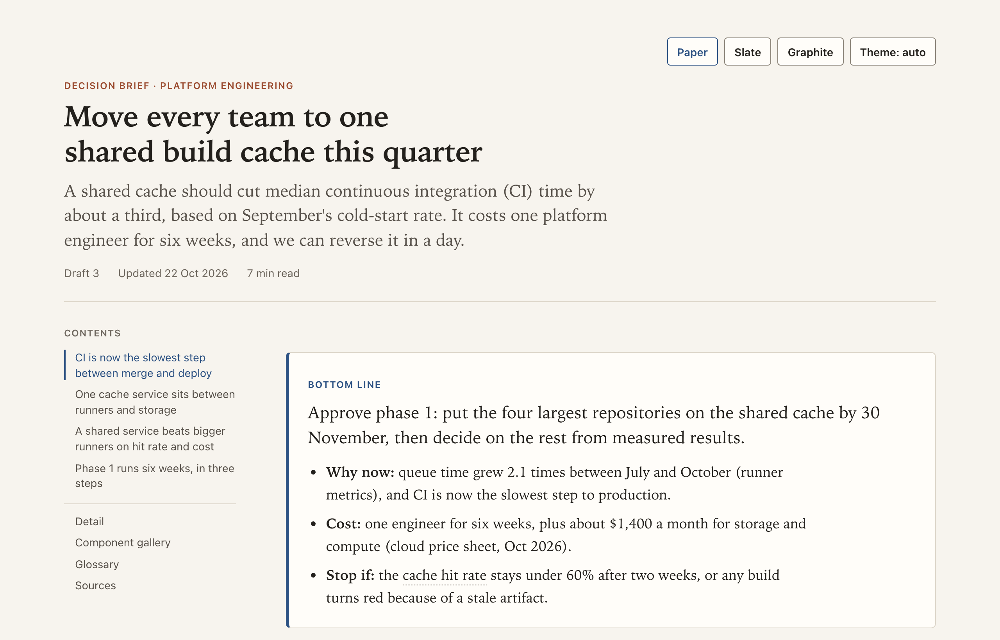

# HTML house style

A Claude skill that makes the HTML pages Claude generates readable, restrained and consistent: briefs, reports, explainers, dashboards, runbooks, reference pages and diagram pages.

Generated pages tend to share one look: a gradient hero, emoji section markers, a grid of identical rounded cards, and diagrams too small to read. This kit replaces that look with a house style built from long feedback on generated pages.

**[See the sample page](https://juliedavila.github.io/html-house-style/)** and use its buttons to switch palettes and themes. Its second half is a gallery of every component.



## What it does

- **Page patterns.** Before choosing a component, Claude names what the reader will do with the page: decide, understand, look up, monitor, do or review. That job sets the opening, the order of sections, the navigation, what the page remembers and how it prints. Each of the six patterns has a [working example](https://juliedavila.github.io/html-house-style/examples/), plus a mixed page: a report with an explorable dataset.
- **Records you can explore.** More than about 25 records in a report become a `section.dataset`: a bar chart that filters the table under it, chips, search and sortable columns, in a frame capped in height. The state lives in the address, Back undoes a change, and a sentence says what the table shows.
- **Charts and tables from data.** `tools/bars.mjs` and `tools/table.mjs` turn data into a finished figure or table (or a whole dataset section) that passes the checker by construction.
- **Answer first.** Pages that argue or report open with a bottom-line block, and every argument heading states a claim, so skimming the headings gives you the argument. Reference and tool pages open with one sentence of purpose.
- **A calm editorial look.** Serif reading text, a sans interface, warm neutral grounds, one accent colour, and space and hairlines in place of boxes.
- **Diagrams you can read.** Diagrams and charts are inline SVG that follows light and dark themes. Figures never draw below their own size, so every label is at least 12px on screen, and every figure has an Enlarge button with zoom.
- **Phone and print.** Pages never scroll sideways on a phone, and they print clean in the light palette even from a machine set to dark mode.
- **One self-contained file.** No CDNs, frameworks, web fonts or network requests, so a page opens from disk and works on locked-down machines.
- **Check before handover.** Where a browser is available, Claude renders the page at desktop and phone widths, in light, dark and print, and looks at it region by region. Where none is, Claude runs `check.mjs`, a static check of label sizes, overflow, colours and structure that needs no browser, and tells you what it could not see.

## What is in the repo

```
html-house-style/          the skill: this inner folder is what you install
  SKILL.md                 when and how Claude uses the kit
  PATTERNS.md              the six page patterns, chosen by the reader's job
  STYLE-GUIDE.md           the full guide, with the reason behind each rule
  base.css                 the stylesheet every page inlines
  template.html            a sample decision brief, then a gallery of every component
  SNIPPETS.md              the shortest correct markup for every component
  CHECKLIST.md             the pre-handover check, split into reading and looking
  check.mjs                static checker: node, bun or deno, no dependencies
  examples/                one working page per pattern, a mixed page and a contents page
  tools/                   page.mjs (skeleton and assembly), bars.mjs, table.mjs, selftest.mjs
index.html                 the sample page, built from template.html and base.css
examples/                  the pattern examples with base.css inlined, for the Pages site
build-index.mjs            rebuilds index.html and examples/
CHANGELOG.md               release notes
docs/screenshot.png        the image above
```

## Install

**Claude Code, every project:**

```sh
git clone https://github.com/juliedavila/html-house-style.git
mkdir -p ~/.claude/skills
cp -R html-house-style/html-house-style ~/.claude/skills/
```

**Claude Code, one repository:** copy the inner folder, the one that contains `SKILL.md`, into that repository's `.claude/skills/`:

```sh
git clone https://github.com/juliedavila/html-house-style.git
mkdir -p path/to/your-repo/.claude/skills
cp -R html-house-style/html-house-style path/to/your-repo/.claude/skills/
```

Either way you should end up with `.claude/skills/html-house-style/SKILL.md`, with `PATTERNS.md` and the `examples/` folder beside it. Start a new session. Claude loads the skill whenever you ask for an HTML page. You can also say "use the html-house-style skill".

**claude.ai** (Pro, Max, Team and Enterprise plans, with code execution turned on): zip the inner `html-house-style` folder and upload it from the Skills page in settings. The menu label has changed over time, so search settings for "Skills". On Team and Enterprise plans an admin enables Skills first. Where skills are not available, add `STYLE-GUIDE.md`, `base.css` and `template.html` to a project's knowledge, or paste the guide at the start of a conversation.

## Run the checker

```sh
node html-house-style/check.mjs path/to/page.html
```

It also runs under `bun` and `deno run --allow-read`. Two modes help in daily use:

```sh
node html-house-style/check.mjs --fragment fig.html        # a figure or table before you splice it in
node html-house-style/check.mjs new.html --was old.html    # a page that replaces another: what was dropped
```

To build and check a page in one step, start from a pattern's skeleton and let `tools/page.mjs` inline `base.css` and the scripts:

```sh
node html-house-style/tools/page.mjs --rules review                 # the pattern's rules
node html-house-style/tools/page.mjs --skeleton review > body.html   # edit body.html
node html-house-style/tools/page.mjs body.html page.html --check     # FAIL and WARN lines only
```

Every run also prints the page's interactions (sort, filter, linked chart, tabs, zoom and so on) and fails when the markup offers one that no script delivers. Run `node html-house-style/tools/selftest.mjs` to check the helpers, `SNIPPETS.md` and `page.mjs`. The checker prints PASS, FAIL, WARN and INFO lines with line numbers, writes out the label-size arithmetic for each figure, and exits 1 on any FAIL. It reads the file with regular expressions and does not render it, so it catches mechanical defects (labels too small, a table that will push a phone sideways, a hard-coded colour, a Mermaid comment leaking into the page) and leaves judgement to you.

## Make it yours

Three palettes ship in `base.css`, each with a light and a dark theme:

| Palette | Feel |
|---|---|
| `paper` (default) | Warm editorial: paper ground, ink text, deep blue accent |
| `slate` | Cool neutral, the safest choice for a corporate audience |
| `graphite` | Near-monochrome with a teal accent, for dense tools |

To add your own, copy a palette block in `base.css` and change the ground, the accent pair and their tints. Section 5.2 of the guide covers the contrast targets. Section 1 describes the reader the kit is tuned for; edit it to match yours.

## Contributing

`index.html` and the root `examples/` folder are generated. Edit `html-house-style/template.html`, `html-house-style/examples/` or `html-house-style/base.css`, then run `node build-index.mjs` from the repo root and commit the sources and the output together. Run `node html-house-style/check.mjs` on `template.html`, `index.html` and every example, and `node html-house-style/tools/selftest.mjs`, before a pull request; each should report zero FAIL.

## License

MIT. See [LICENSE](LICENSE).
